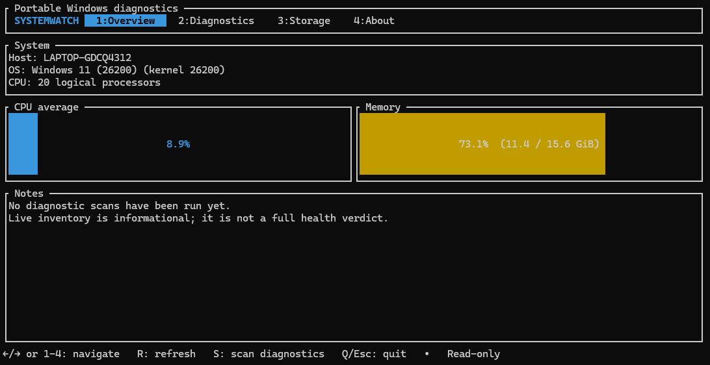

# SystemWatch

**Portable Windows diagnostics. Clear results. No automatic repairs.**

SystemWatch is an interactive terminal application for inspecting a Windows PC, understanding potential problems, and collecting useful diagnostic information — without silently changing system settings.

## What works today

The early preview (0.1.0) currently provides:

- **System overview:** Windows version, computer name, CPU load and physical memory usage.
- **Storage inventory:** mounted volumes, filesystem types, used and total capacity.
- **Device diagnostics:** checks Plug and Play devices for reported Device Manager problem codes.
- **Microsoft Defender:** reads the real-time protection status.
- **Windows Firewall:** checks whether the returned firewall profiles are enabled.
- **Windows Services:** flags only stopped automatic services that also report a non-zero exit code; trigger-start services are not treated as failures.
- **Detailed scan logs:** creates a timestamped log file beside the running executable after each completed scan.
  Logs stay local and may contain the computer name, OS details, and device or service names. Review a log before sharing it.
- **Windows Event Log:** counts Critical and Error events in the System and Application logs over the last 24 hours (sample capped at 501 per log; event message text is not displayed).
- **Physical disk health:** reads Windows Storage health and operational status for detected physical disks, and displays temperature/wear telemetry only when the device exposes it. Unsupported or unavailable health data is reported as unavailable rather than assumed healthy.
- **Interactive terminal UI:** four sections, live inventory refresh, and a manual diagnostics scan.

The diagnostics section runs in the background, so the terminal interface remains responsive. PowerShell output is decoded as UTF-8 for readable error messages. It reports each check as **HEALTHY**, **WARNING**, or **UNAVAILABLE**. A result that could not be read is never treated as a successful check.

## Preview



## Run

A packaged public release is not published yet. To build from source:

```powershell
git clone https://github.com/Caracoto4/SystemWatch.git
cd SystemWatch
cargo run
```

Requirements for building: Rust toolchain and Cargo. The exact supported Windows versions are still being tested.

## Keyboard controls

| Key | Action |
|---|---|
| `1`–`4` | Open a section |
| `←` / `→` or `Tab` | Switch sections |
| `R` | Refresh live inventory |
| `S` | Run diagnostics (Diagnostics section) |
| `Q` or `Esc` | Quit |

## Safety first

SystemWatch is designed to be **read-only by default**.

- It does not automatically repair Windows or modify system settings.
- It does not delete files, stop services, or change security configuration.
- It does not label a PC or process as malicious based on guesswork.
- Checks that cannot run are shown as unavailable, not healthy.

Some future diagnostics may require administrator permissions. The app will explain when a check is unavailable and why.

## Planned diagnostics

- Windows integrity and servicing state
- Deeper SMART attributes and filesystem integrity information
- Deeper event-log analysis
- Network adapters, DNS, routes and connectivity
- Hardware sensor and WHEA indicators
- Detailed driver inventory
- JSON and HTML diagnostic reports

The exact Windows versions supported will be documented after compatibility testing. Older Windows versions are not claimed as supported yet.

## Project status

SystemWatch is under active development. This preview is an initial diagnostic toolkit, not a complete PC health scanner. Features are added incrementally and tested before being marked as available.

- **Language:** Rust
- **Interface:** Ratatui terminal UI
- **License:** MIT

Contributions, bug reports and feature suggestions are welcome.

## Detailed scan reports

After each completed scan, SystemWatch saves a detailed local log beside the running executable. The report begins with system information (Windows build, computer model, CPU, RAM modules, BIOS, motherboard, graphics adapters and drivers, fixed volumes and hardware network adapters), followed by a result section for every diagnostic check.

Each check includes its status, source, summary and detailed findings returned by Windows. The report includes an overall assessment, a concise attention list, status totals, total scan duration, and the duration of each individual check. Unsupported or failed queries remain explicitly marked as unavailable.

Reports may contain the current Windows account name, computer name, hardware identifiers, device and service names, and event metadata. Review the file before sharing it.