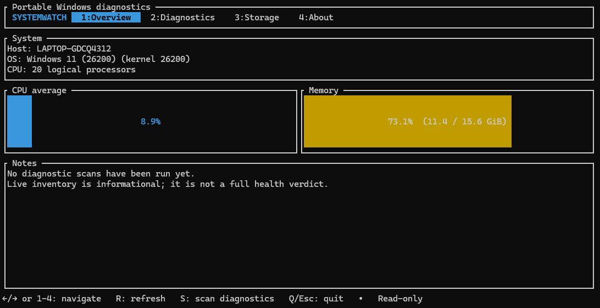

# SystemWatch

<p align="center">
  <strong>Диагностика Windows. Понятные результаты. Без автоматического ремонта.</strong>
</p>

<p align="center">
  <a href="README.md"></a>
  <a href="README.ru.md"></a>
</p>

<p align="center">
  
  
  
  
  
</p>

SystemWatch — диагностическая утилита Windows с интерактивным интерфейсом в терминале. Она собирает сведения о системе, проверяет отдельные компоненты Windows и формирует подробный локальный отчёт, не изменяя настройки компьютера автоматически.

<p align="center">
  
</p>

## Возможности

- **Обзор системы** — версия Windows и ядра, модель и ядра процессора, использование памяти, время работы, архитектура и объём накопителей.
- **Диагностика устройств** — поиск устройств Plug and Play с кодами проблем Диспетчера устройств.
- **Microsoft Defender** — отображение состояния защиты в реальном времени.
- **Брандмауэр Windows** — проверка включённого состояния доступных профилей.
- **Службы Windows** — выявление определённых остановленных автоматических служб с ненулевым кодом завершения.
- **Журнал событий** — подсчёт событий Critical и Error в журналах System и Application за последние 24 часа.
- **Состояние физических дисков** — получение статуса здоровья и работоспособности накопителей, а также доступной телеметрии.
- **Подробные отчёты** — сохранение датированного лога рядом с EXE: сведения о системе, результаты проверок и время выполнения.
- **Интерактивный интерфейс** — навигация по разделам, обновление инвентаризации и запуск диагностики без блокировки интерфейса.

## Безопасность и конфиденциальность

**SystemWatch изначально работает в режиме только для чтения.** Программа не пытается автоматически чинить Windows, менять параметры безопасности, удалять файлы или останавливать службы. Если проверка не смогла получить достоверные данные, результат будет `UNAVAILABLE`, а не `HEALTHY`.

Отчёты сохраняются локально. Они могут содержать имя компьютера и учётной записи, идентификаторы оборудования, названия устройств и служб, а также метаданные событий. Перед отправкой отчёта кому-либо проверьте его содержимое.

## Запуск

Готовый установщик или публичный релиз пока не опубликован. Проект можно собрать из исходного кода:

```powershell
git clone https://github.com/Caracoto4/SystemWatch.git
cd SystemWatch
cargo run
```

**Требования:** Windows, установленный Rust toolchain и Cargo. Совместимость с конкретными версиями Windows пока проверяется.

## Управление

| Клавиша | Действие |
|:---:|---|
| `1`–`4` | Открыть раздел |
| `←` / `→` или `Tab` | Переключить раздел |
| `R` | Обновить сведения о системе |
| `S` | Запустить диагностику в разделе Diagnostics |
| `Q` или `Esc` | Выйти |

## Статусы диагностики

| Статус | Значение |
|---|---|
| `HEALTHY` | Проверка завершилась и не обнаружила проблем в пределах своей области. |
| `WARNING` | Обнаружено состояние, которое стоит проверить. |
| `CRITICAL` | Проверка сообщила о критическом состоянии. |
| `UNAVAILABLE` | Не удалось получить достоверные данные. |

Отсутствие предупреждений не гарантирует, что компьютер полностью исправен: результат описывает только те проверки, которые удалось выполнить.

## Планы развития

- Диагностика целостности Windows и состояния обслуживания
- Расширенные SMART- и файловые проверки
- Диагностика сетевых адаптеров, DNS, маршрутов и подключения
- Информация о WHEA и аппаратных датчиках
- Расширенная инвентаризация драйверов
- Экспорт отчётов в JSON и HTML

## О проекте

SystemWatch находится на ранней стадии разработки. Новые возможности добавляются постепенно и документируются по мере реализации.

- **Язык:** Rust 2021
- **Терминальный интерфейс:** Ratatui + Crossterm
- **Лицензия:** MIT

Сообщения об ошибках, вклад в разработку и предложения приветствуются.